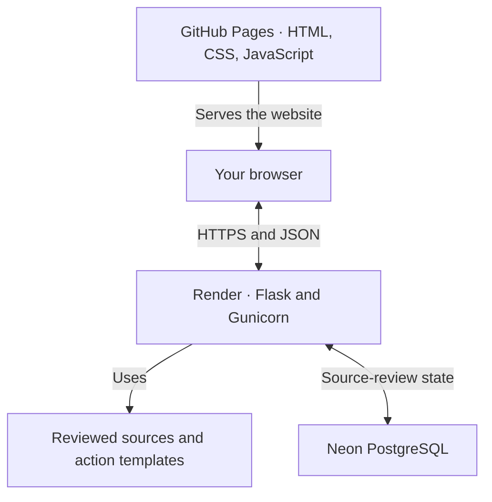
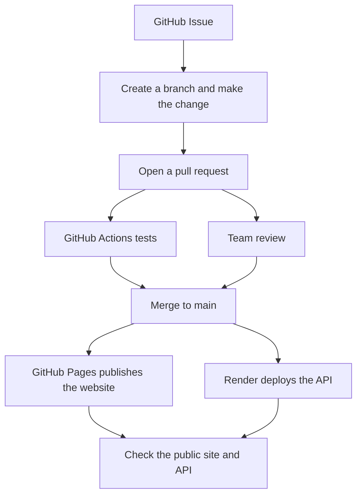

# SG Navi

Trying to get your rental deposit back or resolve a purchase dispute in Singapore? SG Navi helps you work out what to do next, what to prepare, and where to get help.

**[Open SG Navi](https://chu-junjie.github.io/SG-Navi/)** · Free to try in your browser

## How to get started

1. **Describe what happened in English.** A sentence or two is enough to start. You can also choose an example on the homepage.
2. **Confirm the details.** Check that SG Navi understood your situation. If an answer affects the guidance, you may see a follow-up question.
3. **Start with the recommended next step.** Open the steps for your case to see what to prepare, how to contact the other party, and where to get help if the dispute continues. When available, you can open verified contact links, a draft message, and excerpts from the original sources.

| What happened | Example you can try |
| --- | --- |
| **Rental deposit** | My landlord has not returned my S$2,000 deposit. What should I check? |
| **Consumer complaint** | I bought a faulty product for personal use, but the seller will not refund me. |

请用英文描述问题，也可以点击首页示例开始。点击「中文」可查看已有中文版本的结果。

SG Navi is a student project for finding information and preparing your next step. Use the linked organisations to confirm eligibility and submit any formal complaint or claim. Please try it with made-up details and leave out names, contact details, and private documents.

## How SG Navi works

The frontend uses HTML, CSS, and JavaScript on GitHub Pages. The browser sends your description and confirmed answers to a Flask API running with Gunicorn on Render. The API uses reviewed sources and templates to build the guidance. Neon PostgreSQL stores source-review state, including flags for sources that need to be checked again.



See the [case-specific guidance design](docs/task25-case-specific-workflows.md), [shared API contracts](shared/README.md), and [deployment and recovery notes](docs/task7-release-handover.md).

## How we develop and release changes



Found a confusing step or a link that needs updating? Open a GitHub Issue with what you expected, what happened, and a made-up example we can reproduce. For code or documentation changes, follow the repository's contribution rules and check the CI results. [Issues](https://github.com/Chu-Junjie/SG-Navi/issues) · [Contribution rules](AGENTS.md) · [Actions](https://github.com/Chu-Junjie/SG-Navi/actions)

## Run it locally

Install Git and Python 3.12 or newer. The local demo runs without a Render account, Neon database, or API key.

```sh
git clone https://github.com/Chu-Junjie/SG-Navi.git
cd SG-Navi
```

**Windows (PowerShell)**

```powershell
py -3 -m venv .venv
.\.venv\Scripts\python.exe -m pip install -r requirements.txt
.\.venv\Scripts\python.exe -m flask --app integration.app run --host 127.0.0.1 --port 5000
```

**macOS or Linux**

```sh
python3 -m venv .venv
./.venv/bin/python -m pip install -r requirements.txt
./.venv/bin/python -m flask --app integration.app run --host 127.0.0.1 --port 5000
```

Open the [local website](http://127.0.0.1:5000/) and try one of the examples above. See the [test workflow](.github/workflows/test.yml) for the dependency and test commands used by CI.

## Meet the team

| Developer | What they work on |
| --- | --- |
| **Chu Junjie** | Reviewed sources, guidance evidence, shared API contracts, and integration. [GitHub](https://github.com/Chu-Junjie) |
| **Zheng Zaikun** | Flask API, backend tests, and GitHub Actions. [GitHub](https://github.com/ZhengZaikun) |
| **Lu Guanyu** | Website design, user flows, and frontend tests. [GitHub](https://github.com/Guanyu-Lu) |

## License

The source code is publicly available on GitHub. The repository has no software license yet. Please contact the maintainers about reuse or redistribution.
